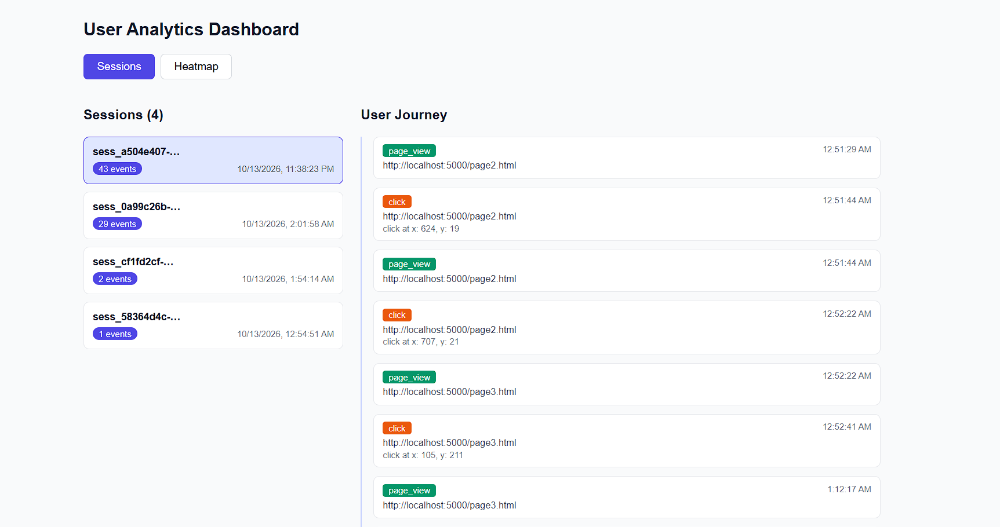
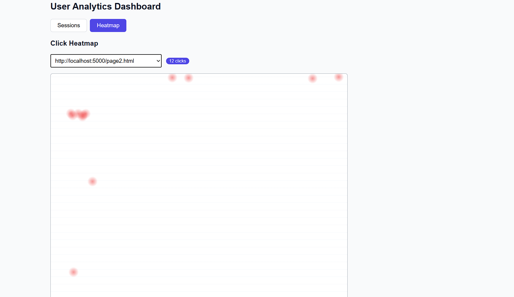

# User Analytics Application

A small full-stack app that tracks page views and clicks on a web page and shows them in a dashboard. Built for the CausalFunnel Full Stack Engineer assignment.

- **Live dashboard:** https://user-analytics-dashboard-mu.vercel.app
- **Live API + demo page:** https://user-analytics-dashboard-a23a.onrender.com/demo.html
- **Code:** https://github.com/Maneesh091/User-analytics-dashboard

> The API is on Render's free tier and sleeps when idle, so the first request can take 30 to 50 seconds. Open the demo link once, wait a minute, then use the dashboard.

## How it works

```
demo pages + tracker.js --POST--> Express API --> MongoDB
                                      ^
                                      | GET
                                React dashboard
```

1. `tracker.js` is added to a page with one `<script>` tag. It sends a `page_view` on load and a `click` (with x/y) on every click. The session ID is created once and kept in `localStorage`.
2. The Express API stores each event in MongoDB and serves the read endpoints.
3. The React dashboard has two views:
   - **Sessions:** all sessions with their event counts. Click one to see its events in order (the user journey).
   - **Click Map (the heatmap view):** pick a page URL and see click positions as dots. Darker red means more clicks.

## Tech stack

Node.js, Express, Mongoose, MongoDB Atlas, React (Vite), plain JavaScript tracker. Hosted on Render (API) and Vercel (dashboard).

## Screenshots




## Run locally

Needs Node.js 18+ and a MongoDB connection string (I used a free Atlas cluster).

```bash
git clone https://github.com/Maneesh091/User-analytics-dashboard.git
cd User-analytics-dashboard
```

**Backend**

```bash
cd backend
npm install
cp .env.example .env     # then set MONGO_URI (and PORT if you like)
node server.js           # prints "Server running on port 5000"
```

**Dashboard** (second terminal)

```bash
cd dashboard
npm install
cp .env.example .env     # VITE_API_URL=http://localhost:5000/api
npm run dev              # http://localhost:5173
```

## How to check that it works

1. Open `http://localhost:5000/demo.html` (not as a `file://` page). Click around, scroll and click lower down, then open Page 2 and Page 3 and click there too.
2. In the browser's Network tab you should see `events` requests with status `201`.
3. Open the dashboard. **Sessions** shows your session with its event count, and clicking it lists the events in order.
4. **Heat Map**: choose a page and your clicks appear as dots.
5. Open the demo in a private window and click. A second session appears.

Refreshing a page adds a new `page_view` to the same session. Switching tabs records nothing.

## API

| Method | Route | Purpose |
|---|---|---|
| POST | `/api/events` | Store one event |
| GET | `/api/sessions` | Sessions with event counts |
| GET | `/api/sessions/:id/events` | Ordered events of one session |
| GET | `/api/pages` | Page URLs that have data |
| GET | `/api/heatmap?url=` | Click positions for a page (optional `&session_id=`) |

Each event stores `session_id`, `type`, `page_url`, `timestamp`, and for clicks `x`, `y`, `page_width`, `page_height`. All events go in one `events` collection with indexes on `(session_id, timestamp)` and `(page_url, type)`.

## Assumptions and trade-offs

- A session is just an ID in `localStorage`. There is no timeout, so the same browser keeps the same session until storage is cleared.
- Coordinates use `pageX/pageY` (scroll-aware). The dashboard turns them into percentages of the page size, so dots land in the right place at any display size.
- Query strings and hashes are removed from the page URL so variants of a page are grouped together.
- Events are sent one by one, with `keepalive: true` so clicks on links are not lost. Tracking errors are ignored so analytics never breaks the host page.
- The click map shows dots on a grid, not over a screenshot of the page. Very different screen sizes are only roughly comparable.
- No authentication and CORS is open, which is fine for this assignment but not for production.
- The dashboard is client-side rendered. It is a private tool with no SEO needs, so Next.js server rendering was not necessary.
- Tested manually, no automated tests yet.

**Next steps:** session timeout, event batching, pagination, recording the clicked element, and tests.

## Author

**Maneesh Singh** · [Email](mailto:singhmaneesh1492@gmail.com) · [LinkedIn](https://www.linkedin.com/in/maneesh-singh-a2498b283/) · [GitHub](https://github.com/Maneesh091)